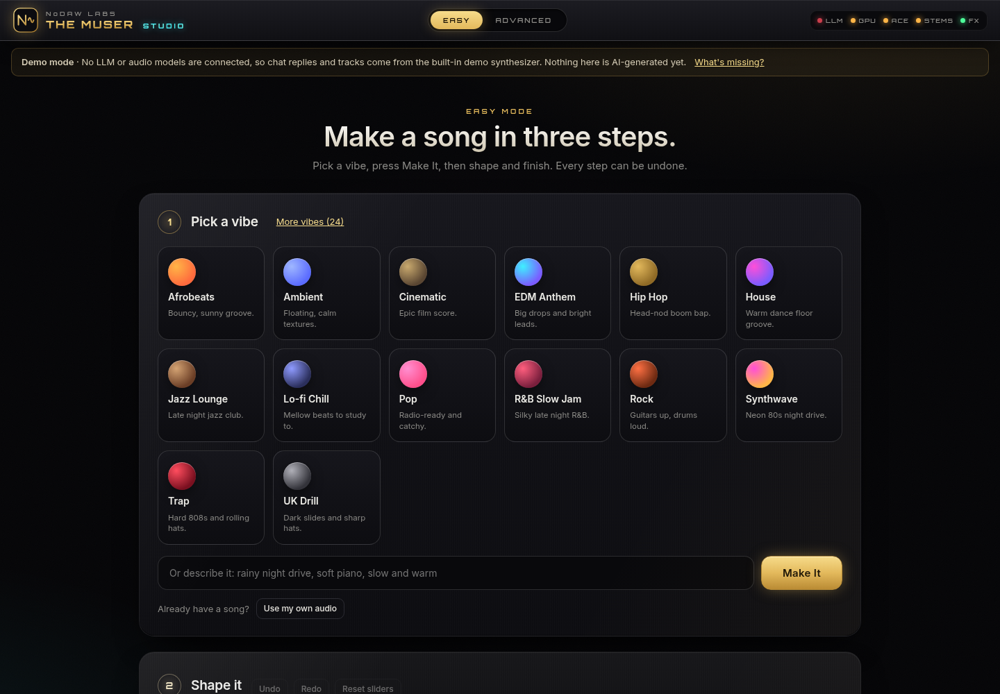

# The Muser Studio: all-in-one AI audio, local and simple

A premium studio front end for [The Muser](https://github.com/noah-chelednik/the-muser)
(the open-source, local AI music composer by Noah Chelednik, MIT licensed).
This fork puts the best open-source audio AI tools under one roof, picks the right one for your PC
automatically, and hides every knob until you ask for it. **Nothing in `src/` was rewritten**:
the original CLI and Gradio UI still work.



---

## Newbie guide (5 minutes)

1. **Install** (once). Follow [Windows setup](#windows-setup-step-by-step) below. One double-click on
   `setup_windows.bat` installs everything you need, including the core audio tools.
2. **Start**. Double-click `start_studio.bat`. Your browser opens the Studio.
3. **Pick a vibe**. Click a tile (Lo-fi, Trap, House...) or type what you want, for example
   "warm late night R&B with soft keys".
4. **Press Make It.** You get a song with separate stems in seconds.
5. **Shape it** with the 5 big sliders: **Energy, Vocals, Bass, Brightness, Space**.
6. **Finish for** Spotify, YouTube, SoundCloud or Club. The Studio masters to the right loudness and
   makes sure nothing clips.
7. **Export**. Done.

Already have a song? Drop it in and use the one-click tools: **Split stems, Remove vocals,
Clean up noise, Match my reference, Turn into MIDI**.

You can't break anything: every step can be undone, the Studio autosaves, it refuses to export silent
or clipping files, and errors tell you what to do in plain words.

## Easy mode and Advanced mode

| | Easy mode (default) | Advanced mode |
|---|---|---|
| Make music | Vibe tiles or a sentence, then **Make It** | Every generation setting: engine, length, BPM, key, seed, steps, guidance |
| Shape | 5 sliders | Per-stem effect chains (EQ filters and shelves, compressor, gate, saturation, delay, reverb, chorus, phaser, width, bitcrush, limiter) built on Spotify Pedalboard |
| Split | One click | Choose the separation model (Demucs, UVR / Roformer models, band split) and 2 or 4 stems |
| Master | Spotify / YouTube / SoundCloud / Club | Detailed mastering: target, custom LUFS, true peak ceiling, an editable master chain, 21 master presets, reference matching |
| Compare | Undo history | A/B compare any two versions |
| Presets | Built into the vibes | **105 presets**: 24 genre, 30 mix, 21 master, 15 vocal, 15 FX |

Switch with the **Easy / Advanced** toggle in the top bar. The Studio remembers your choice.

---

## What fits your GPU (8 GB cards like the RTX 2080 Super)

Open **Engines** in the Studio, or run `.venv\Scripts\python -m studio.server.engines.cli hardware`.
Each tool shows its real VRAM need and a badge for your card:

* **Fits**: recommended and picked automatically.
* **Tight fit**: may run if you close other GPU apps. Never picked automatically; you can still choose it.
* **Not recommended for your card**: needs more memory than you have.

On an **8 GB RTX 2080 Super** the Studio:

* Runs **ACE-Step 1.5** (full songs with vocals, MIT, commercial OK) with its 8 GB profile:
  2B turbo DiT, 0.6B language model on the `pt` backend, CPU offload and INT8 weights.
* Uses **fp16** everywhere, because RTX 20 cards (Turing) have no bf16 or FlashAttention 2.
* Recommends: ACE-Step 1.5, Stable Audio Open (fp16, short clips), Applio (RVC), Seed-VC,
  Resemble Enhance, Demucs and Audio Separator, plus every CPU tool.
  MusicGen small and AudioLDM 2 also fit but are personal use only, so the auto-selector never picks
  them; you can still install them and choose them by hand in Advanced mode.
* Marks as tight: DiffRhythm (8 GB minimum with `--chunked`), AudioSR (reported out of memory on 8 GB).
* Marks as **not recommended**: YuE (official code needs 24 GB+), SongGeneration (10 GB+ and personal
  use only), ACE-Step XL, and the original **24 GB full pipeline** (sft DiT + 1.7B LM + NotaGen).

The upstream ACE-Step loader in `src/` also picks its settings from your VRAM now
(`src/utils/vram_profile.py`). Override with `MUSER_ACESTEP_DIT_MODEL`, `MUSER_ACESTEP_LM_MODEL`,
`MUSER_ACESTEP_OFFLOAD`, `MUSER_ACESTEP_OFFLOAD_DIT`, `MUSER_ACESTEP_QUANT` (`int8_weight_only`,
`fp8_weight_only` or `none`) and `MUSER_ACESTEP_VRAM_BUDGET` in `.env`.
To preview another card, set `MUSER_FORCE_VRAM_GB=8` (and `MUSER_FORCE_COMPUTE_CAP=7.5`).

## Tools and licenses

Everything runs locally. The auto-selector is **commercial-safe** by default: it only picks tools whose
output you can sell, and personal-use tools are labeled wherever you can pick them by hand. "Conditions" means read the note in the Engines panel first (for example, Stable Audio
Open is free under 1 million USD revenue per year, YuE asks for attribution, voice models need consent).

| Tool | Does | Code / weights license | Commercial output | Real VRAM need | Fits 8 GB RTX 2080 Super? | Status here | Windows |
|---|---|---|---|---|---|---|---|
| Sketch Synth (built in) | generate | MIT | Yes | CPU | Yes (CPU) | Working | Native |
| Band Split (built in) | separate | MIT | Yes | CPU | Yes (CPU) | Working | Native |
| Studio DSP (built in) | fx, match, denoise, master, loudness | MIT | Yes | CPU | Yes (CPU) | Working | Native |
| Pitch Tracker (built in) | midi | ISC (librosa) | Yes | CPU | Yes (CPU) | Working | Native |
| Pedalboard (Spotify) | fx | GPL-3.0 | Yes | CPU | Yes (CPU) | Working | Native |
| pyloudnorm | loudness | MIT | Yes | CPU | Yes (CPU) | Working | Native |
| noisereduce | denoise | MIT | Yes | CPU | Yes (CPU) | Working | Native |
| Basic Pitch (Spotify) | midi | Apache-2.0 | Yes | CPU | Yes (CPU) | Working | Native |
| Matchering 2 | match | GPL-3.0 | Yes | CPU | Yes (CPU) | Working | Native |
| Audio Separator (UVR models) | separate | MIT / varies per model (most UVR community models are MIT or unspecified) | Conditions | CPU (GPU optional) | Yes | Working | Native |
| Demucs v4 (Meta) | separate | MIT | Yes | CPU (GPU optional) | Yes | Working | Native |
| DeepFilterNet 3 | denoise | MIT OR Apache-2.0 | Yes | CPU | Yes (CPU) | Working | Native |
| ACE-Step 1.5 | generate | MIT | Yes | 4 to 20 GB | Yes, low-memory settings | Adapter, untested here | Native |
| DiffRhythm | generate | Apache-2.0 | Yes | 8 to 12 GB | Tight, not default | Adapter, untested here | Partial |
| YuE | generate | Apache-2.0 / CC BY-NC 4.0 (see model card) | Conditions | 8 to 24 GB | **Not recommended** | Adapter, untested here | WSL suggested |
| SongGeneration / LeVo (Tencent) | generate | Custom (Tencent) / Custom, research and education only | No (personal use) | 10 to 16 GB | **Not recommended** | Adapter, untested here | WSL suggested |
| Stable Audio Open | generate | MIT (stable-audio-tools) / Stability AI Community License | Conditions | 6 GB | Yes | Adapter, untested here | Native |
| MusicGen (Meta AudioCraft) | generate | MIT / CC BY-NC 4.0 | No (personal use) | 4 to 16 GB | Yes, low-memory settings | Adapter, untested here | Native |
| AudioLDM 2 | generate | MIT / CC BY-NC-SA 4.0 | No (personal use) | 6 GB | Yes | Adapter, untested here | Native |
| Applio (RVC) | voice | MIT / per voice model | Conditions | 4 GB | Yes | Adapter, untested here | Separate app |
| Seed-VC | voice | GPL-3.0 | Conditions | 4 to 6 GB | Yes | Adapter, untested here | Native |
| AudioSR | enhance | MIT | Yes | 6 to 8 GB | Tight, not default | Adapter, untested here | Native |
| Resemble Enhance | enhance, denoise | MIT | Yes | 4 GB | Yes | Adapter, untested here | Native |
| Full pipeline (original Muser, 24 GB) | generate | MIT + model licenses | Yes | 20 to 24 GB | **Not recommended** | Upstream | Native |

"Adapter, untested here" means the wrapper follows the project's official instructions but was not run
on the build machine (no GPU there). Heavy models install with one click from **Engines**.

**Pedalboard and Matchering are GPL-3.0.** The Studio uses them as libraries in your own local
copy, which is fine. GPL covers the code, not your audio: **your exported songs are yours and
commercial use is OK.** If you redistribute a modified Studio, share its source under the GPL.

See [docs/legal.md](docs/legal.md) for the full ownership guide.

---

## Windows setup step by step

### 1. Install the prerequisites (once)

Open **PowerShell** and run:

```powershell
winget install Git.Git
winget install Python.Python.3.11
winget install OpenJS.NodeJS.LTS
winget install Gyan.FFmpeg
winget install Ollama.Ollama
```

Close and reopen PowerShell afterwards. (Python **3.10 to 3.12** only. Node **20.19+**.)
Install the current **NVIDIA driver** if you have an NVIDIA card (`nvidia-smi` should print your GPU).

### 2. Get the code

```powershell
cd $HOME\Documents
git clone https://github.com/myaiplug/the-muser.git
cd the-muser
```

### 3. Run setup

Double-click **`setup_windows.bat`**, or from PowerShell:

```powershell
.\setup_windows.bat                 # Studio + core audio tools (recommended start)
.\setup_windows.bat -Gpu            # + CUDA PyTorch for NVIDIA cards (do this on an RTX 2080 Super)
.\setup_windows.bat -Separate       # + Audio Separator (UVR / Roformer stem models)
.\setup_windows.bat -Denoise        # + DeepFilterNet voice cleanup
.\setup_windows.bat -Extras separate,demucs,denoise
.\setup_windows.bat -Voice          # + CPU PyTorch + Demucs
```

Setup creates `.venv`, installs the core tools (Pedalboard, pyloudnorm, noisereduce, Basic Pitch,
Matchering), builds the web UI, checks Ollama, ffmpeg and your GPU, and ends with a **hardware check**
that lists which AI models fit your card.

### 4. (Optional) Pull an LLM for the chat composer

```powershell
ollama pull qwen3:8b
```

Quit Ollama from the system tray and start it again afterwards so it picks up
`OLLAMA_CONTEXT_LENGTH=16384`.

### 5. Launch

Double-click **`start_studio.bat`**: your browser opens **http://127.0.0.1:8765**.

```powershell
.\start_studio.bat -Demo        # force demo mode (no LLM or models)
.\start_studio.bat -Gradio      # also start the original Gradio UI at http://localhost:7860
.\start_studio.bat -Port 9000
```

### 6. Add AI models

Open **Engines**, find a model marked **Fits**, press **Install**. On an 8 GB card start with
**ACE-Step 1.5**.

### Updating

```powershell
cd $HOME\Documents\the-muser
git pull
.\setup_windows.bat -Gpu
```

Rerunning setup is safe: it only adds what is missing. Then start the Studio as usual.

---

## Hardware notes

* **8 GB NVIDIA (RTX 2070 / 2080 / 3060 Ti / 4060):** ACE-Step 1.5 low-memory profile and every
  model marked Fits. Models load one at a time.
* **12 to 16 GB:** adds DiffRhythm, SongGeneration low memory, AudioSR, ACE-Step with the 1.7B LM.
* **24 GB (RTX 3090 / 4090):** everything at full quality, including the original full pipeline and YuE.
* **CPU only:** every Easy mode tool works (sketch synth, split, cleanup, match, MIDI, mastering).
* **Disk:** Python deps about 3 GB with PyTorch; each AI model is 2 to 20 GB.

## How it fits together

```
studio/
  server/
    app.py, routes_v2.py   REST API (python -m studio.server), serves the built UI
    engines/               registry (licenses, VRAM profiles, health), hardware check,
                           auto-selector, installer, adapters, DSP, CLI
    presets.py             preset library loader (studio/presets/*)
  presets/                 105 JSON presets + Easy slider maps
  web/                     Vite + React + TypeScript UI (Easy and Advanced modes)
  tools/                   headless UI smoke tests (Playwright)
setup_windows.ps1/.bat     Windows setup, extras flags, hardware check
start_studio.ps1/.bat/.sh  launchers
```

### Development

```powershell
.\.venv\Scripts\python -m studio.server --reload     # API on :8765
cd studio\web; npm run dev                            # hot-reload UI on :5173
.\.venv\Scripts\python -m pytest tests\test_studio_engines.py tests\test_studio_v2_api.py
```

## Credits and license

The Muser (c) The Muser Contributors, MIT, see [LICENSE](LICENSE), [NOTICE](NOTICE) and
[THIRD_PARTY_LICENSES.md](THIRD_PARTY_LICENSES.md). Upstream: https://github.com/noah-chelednik/the-muser.
Studio front end by NoDAW Labs, released under the same MIT license. Each integrated tool keeps its own
license, listed above.
