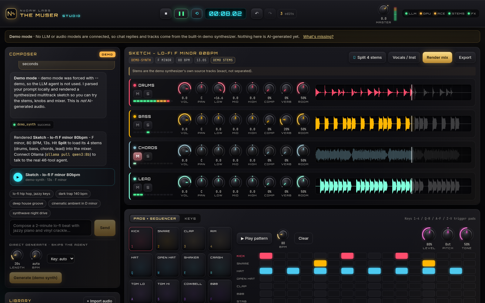

# The Muser Studio — NoDAW Labs front end

A premium, hardware-style studio front end for [The Muser](https://github.com/noah-chelednik/the-muser)
(the open-source, local AI music composer by Noah Chelednik, MIT licensed).
This fork adds a web studio + a thin Python API on top of the existing agent and tools.
**Nothing in `src/` was rewritten** — the original CLI and Gradio UI still work.



## What you get

| Area | What it does | Backed by (repo code) |
|---|---|---|
| **Composer** | Natural-language chat with the 46-tool agent, streamed token-by-token, with live tool-call chips | `src.orchestrator.agent.run_agent_turn` (same call the Gradio UI makes) |
| **Direct generate** | Prompt + length / BPM / key → audio | `generate_audio_acestep_v15` tool (ACE-Step) — or the demo synth when ACE-Step isn't available |
| **Stem split** | "Split 4 stems" (vocals / drums / bass / other) or "Vocals / Inst" | `src.voice.demucs_wrapper.separate_stems` (Demucs htdemucs) |
| **Stem mixer** | One lane per stem: waveform, LED meter, Mute/Solo, Vol, Pan, Low/Mid/High EQ, Comp, Reverb, Room — all live in the browser | Web Audio preview of the same chain |
| **Render mix** | Bakes every stem's settings server-side and sums them into a new track | `src.audio.effects` (`apply_eq`, `apply_compression`, `apply_reverb`, `adjust_volume`) + `src.audio.mixer.mix_n_tracks` |
| **Export** | WAV / MP3 / FLAC, loudness-normalized, optional stems .zip | `src.audio.export.export_composition` (`export_final` tool) |
| **Undo / Redo** | Every knob turn, mute, solo, pattern step and synth tweak; a knob drag = one step. `Ctrl+Z`, `Ctrl+Shift+Z` / `Ctrl+Y`, history list | front end (`studio/web/src/state/history.ts`) |
| **Pads + sequencer** | 16 synthesized pads (keys `1-4 / Q-R / A-F / Z-V`) and a 16-step pattern sequencer with BPM knob | Web Audio |
| **Keys** | 25-key velocity-sensitive piano + polysynth (wave, cutoff, reso, attack, release, detune), QWERTY playable (`A W S E D F T G Y H U J K…`, `Z/X` octave) | Web Audio |
| **System panel** | LEDs for LLM / GPU / ACE-Step / Demucs / ffmpeg, with what's missing and how to fix it | `studio/server/capabilities.py` |

Knobs: drag up/down, mouse-wheel, `Shift` for fine control, double-click to reset, arrow keys when focused.
`Space` = play/pause.

### Modes (shown as a badge in the UI)

* **DEMO** — no LLM reachable. Chat replies come from a local prompt parser and audio comes from the
  built-in **demo synthesizer** (numpy: drums / bass / chords / lead rendered as real separate stems).
  This is clearly labeled and is **not AI-generated**; it exists so every control is usable without models.
* **HYBRID** — LLM agent connected (Ollama or a cloud key), but no ACE-Step weights / CUDA. Chat is the real
  agent; the "Direct generate" button falls back to the demo synth.
* **FULL** — LLM + ACE-Step (CUDA GPU + weights, or `MUSER_ACESTEP_API_URL`). Generation uses ACE-Step.

Splitting uses real Demucs whenever it's installed (`-Voice` or `-Gpu` setup). Without Demucs,
uploaded audio gets a 4-band crossover split, labeled **BAND SPLIT (fallback)** — not true source separation.

## Hardware notes

* **Full pipeline (ACE-Step / NotaGen / DiffSinger / RVC):** NVIDIA GPU with **~24 GB VRAM** (RTX 3090 / 4090 class),
  per upstream. Models load one at a time (see `VRAM_BUDGET` in `src/orchestrator/config.py`).
* **CPU only:** LLM orchestration (Ollama) + Studio + Demucs (slow but works: ~2–3× real time on CPU) + mixing/export.
  Audio generation falls back to the demo synth.
* **RAM:** `qwen3:8b` wants ~8 GB free; `qwen3:30b-a3b` (upstream default) wants ~20 GB+.
* **Disk:** Python deps ~3 GB with PyTorch; model weights are 10s of GB.

---

## Windows setup — step by step

### 1. Install the prerequisites (once)

Open **PowerShell** and run:

```powershell
winget install Git.Git
winget install Python.Python.3.11
winget install OpenJS.NodeJS.LTS
winget install Gyan.FFmpeg
winget install Ollama.Ollama
```

Close and reopen PowerShell afterwards so the new commands are on PATH.
(Python **3.10–3.12** only — 3.13 has no wheels for `numpy<2`. Node **20.19+**.)

If you have an NVIDIA card, make sure the current **NVIDIA driver** is installed (`nvidia-smi` should print your GPU).

### 2. Get the code

```powershell
cd $HOME\Documents
git clone https://github.com/myaiplug/the-muser.git
cd the-muser
```

### 3. Run setup

Double-click **`setup_windows.bat`**, or from PowerShell pick one:

```powershell
.\setup_windows.bat            # Studio + agent + Gradio (no PyTorch)  — quickest
.\setup_windows.bat -Voice     # + CPU PyTorch + Demucs (real stem splitting)
.\setup_windows.bat -Gpu       # + CUDA PyTorch + GPU/voice extras (NVIDIA only)
```

It creates `.venv`, installs Python packages, builds the web UI (`studio\web\dist`), creates `.env`,
sets `OLLAMA_CONTEXT_LENGTH=16384` for your user, and checks **Ollama, ffmpeg and nvidia-smi**,
printing anything that is missing with the command to fix it.

### 4. Pull an LLM for the agent

```powershell
ollama pull qwen3:8b          # good default for 16 GB RAM machines
# ollama pull qwen3:30b-a3b   # upstream default, needs a lot more memory
```

> **Important:** the agent's system prompt + 46 tool schemas is ~12k tokens. After setup, **quit Ollama from the
> system tray and start it again** so it picks up `OLLAMA_CONTEXT_LENGTH=16384`. Without that, recent Ollama
> versions reject the request ("exceeds the available context size").

### 5. Launch

Double-click **`start_studio.bat`** → your browser opens **http://127.0.0.1:8765**.

Options:

```powershell
.\start_studio.bat -Demo        # force demo mode (no LLM / models)
.\start_studio.bat -Gradio      # also start the original Gradio UI at http://localhost:7860
.\start_studio.bat -Port 9000
```

### 6. (Optional) Full pipeline on an NVIDIA GPU

1. `.\setup_windows.bat -Gpu`
2. Download model weights. Upstream's `scripts/setup_models.sh` is a bash script — run it from **Git Bash**
   (installed with Git) or WSL: `bash scripts/setup_models.sh`. Weights go in `models\` (e.g. `models\ace-step-v15\`).
   Or point at a running ACE-Step server with `MUSER_ACESTEP_API_URL` in `.env`.
3. Restart `start_studio.bat`; the badge should read **FULL** and the ACE LED turns green.

---

## How it fits together

```
studio/
  server/                FastAPI layer (python -m studio.server)
    app.py               REST + SSE routes, serves the built UI
    agent_bridge.py      streams run_agent_turn() tokens + tool calls as SSE
    engine.py            generate / split / per-stem FX / mixdown / export via repo tools
    capabilities.py      detects Ollama, ffmpeg, GPU, torch CUDA, ACE-Step weights, Demucs
    demo_synth.py        demo-mode multitrack synthesizer + band-split fallback
    store.py             track library (studio_data/) + background jobs
  web/                   Vite + React + TypeScript UI
    src/audio/engine.ts  Web Audio multi-stem player + per-lane FX chain
    src/audio/instruments.ts  pads, polysynth, step sequencer
    src/state/history.ts undo/redo
    src/components/      Knob, Waveform, Meter, Mixer, Deck, Composer, Library, TopBar...
tests/test_studio_api.py API tests (demo mode)
setup_windows.ps1/.bat   Windows setup + dependency check
start_studio.ps1/.bat/.sh  launchers
```

API (all JSON; long operations return a `job_id` to poll at `/api/jobs/{id}`):
`GET /api/status`, `POST /api/chat` (SSE: `token`, `tool_start`, `tool_end`, `track`, `final`, `done`),
`GET /api/tracks`, `POST /api/generate`, `POST /api/tracks/{id}/split`, `POST /api/mix`, `POST /api/export`,
`POST /api/upload`, `GET /files/...`. Studio data lives in `studio_data\` (git-ignored).

### Development

```powershell
.\.venv\Scripts\python -m studio.server --reload     # API on :8765
cd studio\web; npm run dev                            # hot-reload UI on :5173 (proxies /api)
.\.venv\Scripts\python -m pytest tests\test_studio_api.py -v
```

## Dependency fixes made in this fork

* `web` extra: `gradio>=4.44,<6` (Gradio 4.x crashes on start with current pydantic) and
  `huggingface_hub<1.0` (Gradio imports `HfFolder`, removed in hub 1.x). The original Gradio UI runs on Gradio 5.
* `mcp` added to `web`/`studio` extras: current `litellm` imports it whenever tools are passed, so every agent call
  failed with `No module named 'mcp'`.
* New `studio` extra: fastapi, uvicorn, python-multipart, httpx.

## Credits & license

The Muser © The Muser Contributors — MIT, see [LICENSE](LICENSE), [NOTICE](NOTICE) and
[THIRD_PARTY_LICENSES.md](THIRD_PARTY_LICENSES.md). Upstream: https://github.com/noah-chelednik/the-muser.
Studio front end by NoDAW Labs, released under the same MIT license.
